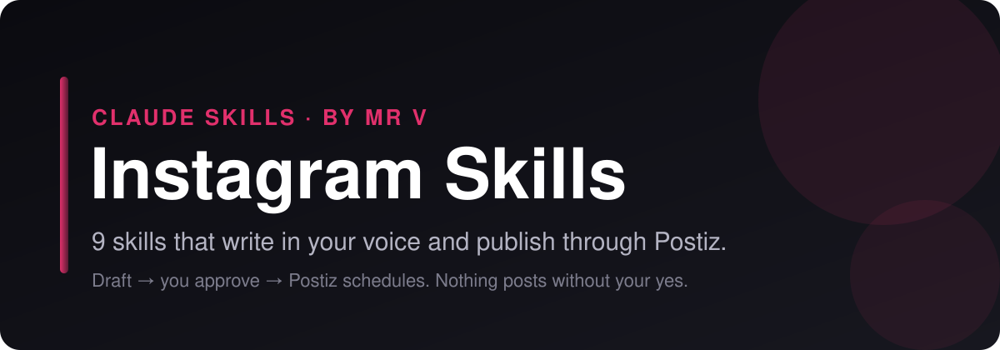

<p align="center">
  
</p>

# Instagram Skills for Claude Code, Claude.ai and Codex

<p align="center">
  
  
  
  
  
</p>

**Claude skills for Instagram.** 9 skills that plan, write, scrub and publish your Instagram content. They draft in your voice, strip the AI tells, and hand finished posts to [Postiz](https://postiz.com) for scheduling, only after you approve. No coding required.

> **On another platform too?** Matching bundles: [LinkedIn](https://github.com/mrvsubstack/linkedin-skills) · [X (Twitter)](https://github.com/mrvsubstack/x-skills) · [Threads](https://github.com/mrvsubstack/threads-skills) · [YouTube](https://github.com/mrvsubstack/youtube-skills) · [Facebook](https://github.com/mrvsubstack/facebook-skills) · [TikTok](https://github.com/mrvsubstack/tiktok-skills) · [Pinterest](https://github.com/mrvsubstack/pinterest-skills) · [Reddit](https://github.com/mrvsubstack/reddit-skills). Same voice rules, same approve-before-publish flow.

> **Want the full library?** These are a free sample of the Mr V Skills library: 240+ skills for writing, newsletters, offers, ads, SEO and research. [Get it on Substack →](https://promptwithjason.substack.com)

## Install

### Claude.ai (web) or Claude Desktop

1. Click **Customize** in the sidebar and open **Plugins**
2. **Add** → **Add marketplace** → **Add from a repository**
3. Paste `mrvsubstack/instagram-skills` and sync
4. Open **Discover**, find **instagram-skills**, click **+** to install
5. Start a new chat and ask for a Instagram post

> Plugins need a paid Claude plan with code execution turned on.

### Claude Code

```
/plugin marketplace add mrvsubstack/instagram-skills
/plugin install instagram-skills@instagram-skills
```

Or clone it and open the folder. The `.claude/skills/` folder points at every skill, so they load with no install:

```bash
git clone https://github.com/mrvsubstack/instagram-skills.git
cd instagram-skills
```

### Any agent (Codex, Cursor and others)

```bash
npx skills add mrvsubstack/instagram-skills
```

Or point your agent at `skills/*/SKILL.md`. Each one is plain markdown.

> **Found this useful? [Star the repo](https://github.com/mrvsubstack/instagram-skills).** It's how the next person finds it.

## What you can do

Ask in plain English. The right skill picks itself.

**Write a caption:**
> "Write an Instagram caption for this carousel about meal prep for nurses."

**Plan a carousel:**
> "Plan a 7-slide carousel that gets saved: [topic]"

**Pick hashtags:**
> "Give me 5 hashtags I can actually rank in for home baking."

**Plan the week:**
> "Weekly Instagram plan: Reels, carousels and stories for a fitness coach."

**Ship it:**
> "Schedule this carousel to Instagram through Postiz for Friday 6pm."

Every skill shows you a draft first. Nothing goes out until you say yes.

## The 9 skills

| Skill | What it does |
|---|---|
| **Caption Writer** (`ig-caption-writer`) | Writes an Instagram caption for a single image or a Reel: a hook that works in the first ~125 characters before "more", a skimmable body, one specific call to action and a small sized hashtag set, delivered as a copy-ready block. |
| **Carousel Planner** (`ig-carousel-planner`) | Plans an Instagram carousel slide by slide — a hook slide that earns the swipe, the best value up front, one point per slide, and a final slide worth saving — plus the caption, delivered as a slide-by-slide script you can drop into Canva or any design tool. |
| **Content Planner** (`ig-content-planner`) | Builds a 7-day Instagram plan: which days get a Reel, carousel, single image or story set, the pillar and hook for each, the reaction each post must earn, a daily story rhythm and a weekly saves-and-sends target. |
| **Hashtag Strategist** (`ig-hashtag-strategist`) | Builds a small, sized Instagram hashtag set for one post — mostly niche tags you can actually rank in, one mid-size, at most one broad — matched to what the post is really about and rotated so it never looks automated. |
| **Hook Extractor** (`ig-hook-extractor`) | Takes an Instagram Reel, carousel or caption that did well and breaks it down: which hook it uses, how each slide or beat is built, what reaction it was chasing, why it worked, what not to copy, and a blank template for your own topic. |
| **Profile Optimizer** (`ig-profile-optimizer`) | Audits an Instagram profile the way a stranger sees it — photo, name field, handle, bio, link, category, highlights, top grid and pinned posts — and rewrites each weak part so a visitor knows in seconds who you are for and why to follow. |
| **Repurposer** (`ig-repurposer`) | Rebuilds content you already made — a LinkedIn post, blog, newsletter, YouTube script, tweet or thread — into a native Instagram post: a carousel when the idea has steps, a caption post or Reel caption when it's one sharp point, re-hooked for the 125-character cut with off-platform leftovers removed. |
| **Humanizer** (`ig-humanizer`) | Removes the patterns that make an Instagram caption or carousel slide read machine-written — clusters of AI words, reveal bridges, fragment stacks, emoji storms, performed honesty — without sanding off the writer's voice. Three modes: Rewrite (default), Audit (pre-post pass/fail on hook, length, hashtags, emoji and call to action) and Profile (learn your voice from 3–6 past captions). |
| **Postiz Publisher** (`ig-postiz-publisher`) | Checks a finished post against Instagram's rules, shows you an approval card, and schedules it through Postiz after you say yes. Saves a copy-ready file when Postiz isn't set up. |

Some skills suggest companion skills from the other platform bundles or from the [full Mr V library](https://promptwithjason.substack.com) (for example `voice-profile-bank` or `final-edit-modes`). They're optional. Without them, each skill still does its whole job.

## Publish with Postiz

By default the skills hand you a copy-ready post. Connect [Postiz](https://postiz.com) and Claude can schedule it for you.

**Why Postiz:** it's open source, you can self-host it for free, and one account covers Instagram plus 25+ other channels. The hosted plan works too.

**Setup (5 minutes):**

1. Create a Postiz account (or self-host it) and connect Instagram under **Add Channel**.
2. Copy your API key from **Settings** → **Public API**.
3. Save it as an environment variable, not in the chat:
   ```bash
   export POSTIZ_API_KEY="your-key"
   # self-hosted only:
   export POSTIZ_API_URL="https://your-domain/api/public/v1"
   ```
4. Restart Claude and ask: **"List my Postiz channels."**

Full guide: [`skills/ig-postiz-publisher/references/postiz-setup.md`](skills/ig-postiz-publisher/references/postiz-setup.md).

**How a post ships:**

1. A writer skill drafts the post.
2. You edit until you like it.
3. `ig-postiz-publisher` checks it against Instagram's limits and shows an approval card: account, local time and UTC, media, exact text.
4. You say yes. It schedules through Postiz and gives you the post id.

No key? It saves the post to `post-ready-to-paste.txt` instead. Nothing breaks.

**Not published through Postiz:** Comment replies and DMs.

## Voice rules every skill follows

1. A number or a statement in line 1. Never open on a question.
2. Odd precision beats round numbers: "$4,730" reads like a receipt, "$5k" like a guess.
3. One real detail per post. If you didn't give one, the skill asks. It never invents one.
4. No stock AI words (leverage, robust, elevate, navigate, foster, delve).
5. No reveal bridges ("Here's the thing", "Plot twist:") and no staccato stacks ("Simple. Fast. Done.").
6. Em dashes capped at about one per 100 words.

## Troubleshooting

| Problem | Fix |
|---|---|
| Skills don't activate | Start a new chat after installing. In Claude Desktop, check the plugin is listed under **Yours**, not only **Discover**. |
| "Postiz isn't connected" | `POSTIZ_API_KEY` isn't visible to Claude. Set it in your shell profile, open a new terminal, restart Claude. |
| 401 from Postiz | The key is wrong or was regenerated. Copy it again from Settings → Public API. |
| 429 from Postiz | You hit Postiz's hourly posting limit. Wait and try again. |
| Instagram channel not found | Connect it in the Postiz dashboard, or reconnect it if it shows as disabled. |
| Validation error on a post | A required platform setting is missing. The publisher reads the error and asks you for it. |

## Credits and license

Several skills here were rewritten in Mr.V's own words from methods in Serge Bulaev's MIT-licensed [instagram-skills](https://github.com/sergebulaev/instagram-skills). See [CREDITS.md](CREDITS.md).

MIT licensed. See [LICENSE](LICENSE). Not affiliated with Instagram or Postiz.

Made by **Mr.V** · [Substack](https://promptwithjason.substack.com)
